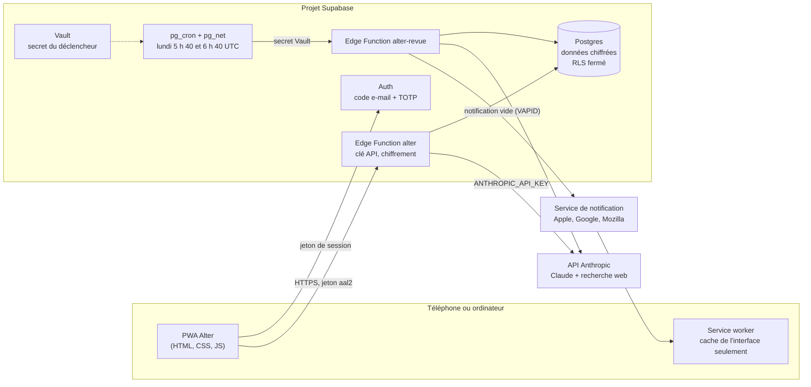

# Alter PWA : architecture et déploiement

Alter est installable sur iPhone, Android, Mac et Windows depuis le navigateur. La page web ne détient aucun secret et ne garde aucune donnée confidentielle : elle parle à une seule Edge Function Supabase. C'est cette fonction qui garde la clé d'API, chiffre les données et appelle Claude.

| Document | Contenu |
|---|---|
| [README.md](./README.md) | Architecture, sécurité, déploiement pas à pas |
| [PLATEFORMES.md](./PLATEFORMES.md) | Limites par plateforme, dont les notifications sur iOS |
| [COUTS.md](./COUTS.md) | Estimation des coûts mensuels selon trois niveaux d'usage |
| [NLPD.md](./NLPD.md) | Points à valider avec l'avocat et l'hébergeur |
| [IMPORT.md](./IMPORT.md) | Reprise unique du portefeuille du QG claude.ai |

## 1. Vue d'ensemble



### Ce qui circule et où

| Donnée | Navigateur | Edge Function | Base Postgres | Anthropic | Service de notification |
|---|---|---|---|---|---|
| Clé d'API Anthropic | jamais | secret de la fonction | jamais | n/a | jamais |
| Clé de chiffrement | jamais | secret de la fonction | jamais | jamais | jamais |
| Portefeuille, journal, fil | en mémoire pendant la session | en clair le temps du traitement | chiffré (AES-256-GCM) | en clair dans la requête | jamais |
| Jeton de session | localStorage (voir § 3) | vérifié à chaque appel | géré par Supabase Auth | jamais | jamais |
| Notification du lundi | affichée par le service worker | n/a | adresse d'abonnement | jamais | message vide |

## 2. Fichiers

```
pwa/
  index.html             page de l'application (avec politique CSP)
  styles.css             interface, thèmes clair et sombre
  app.js                 chat, voix, portefeuille, blocs QG, connexion
  sw.js                  service worker : cache de l'interface + notification
  manifest.webmanifest   installation (nom, icônes, couleurs, raccourci « Revue »)
  icons/                 192, 512, maskable 512, apple-touch 180, favicon SVG
  config.exemple.js      modèle de config.js (valeurs publiques uniquement)
  artefact.html          version d'essai pour claude.ai, générée par scripts/construire-artefact.mjs
supabase/
  migrations/…_alter_init.sql         tables chiffrées, RLS fermé, mise à jour avec version
  migrations/…_alter_cron_revue.sql   déclencheur du lundi
  migrations/…_alter_imports.sql      trace des imports (empreinte seulement)
  functions/alter/index.ts            API de la PWA (état, chat en flux, validation, notifications)
  functions/alter-revue/index.ts      revue hebdomadaire + notification
  functions/_shared/                  auth, chiffrement, QG, import, appel à Claude, Web Push
    prompt.exemple.ts                 modèle ; le vrai prompt va dans prompt.ts (ignoré par git)
scripts/
  generer-secrets.mjs    génère la clé de chiffrement, le secret du déclencheur et les clés VAPID
  icones.py              régénère les icônes
  construire-artefact.mjs
```

## 3. Sécurité

**Authentification.** La connexion se fait par un code à six chiffres reçu par e-mail. Un code, et non un lien magique : sur iPhone, un lien s'ouvrirait dans Safari, pas dans l'application installée. Le second facteur passe ensuite par une application d'authentification (TOTP). L'Edge Function refuse tout appel qui ne remplit pas ces trois conditions :
1. jeton valide auprès de Supabase Auth ;
2. identifiant égal au secret `ALTER_OWNER_ID` ;
3. niveau `aal2`, c'est-à-dire second facteur passé.

Dans Supabase, désactive les inscriptions : un seul compte existe, créé à la main.

**Données.**
- Chaque fiche, entrée de journal, message, bloc et revue est chiffré en AES-256-GCM par l'Edge Function. La clé `ALTER_DATA_KEY` est un secret de la fonction, jamais stocké en base.
- Chaque valeur chiffrée est liée à sa ligne (table, propriétaire, identifiant). Une valeur copiée dans une autre ligne ne se déchiffre pas.
- Les tables ont RLS activé et aucune politique, et les droits sont retirés aux rôles `anon` et `authenticated`. Le navigateur ne peut donc rien lire directement, même avec un jeton valide.
- Les mises à jour de fiche contrôlent la version : si la fiche a changé entre la proposition d'Alter et ta validation, le bloc est marqué « périmé » au lieu d'écraser la fiche.

**Navigateur.**
- Le portefeuille, le journal et la conversation ne vivent qu'en mémoire.
- Le service worker ne met en cache que l'interface. Les appels vers Supabase ne sont jamais copiés.
- Seuls deux éléments restent dans `localStorage` : les préférences d'affichage et le jeton de session Supabase. Ce dernier évite de se reconnecter à chaque ouverture. Il ne donne rien sans le second facteur déjà validé, et la déconnexion l'efface.
- Pour ne rien garder du tout, mets `persistSession: false` dans `app.js` : il faudra alors se reconnecter à chaque ouverture.

**Limites assumées.**
- Les opérateurs de Supabase qui ont accès aux secrets des fonctions et à la base pourraient techniquement déchiffrer.
- Claude reçoit le contenu en clair pour répondre.
- Un chiffrement de bout en bout (clé connue du seul navigateur) empêcherait la revue automatique du lundi.

**Prompt système.** Le dépôt est public. Le prompt complet d'Alter va dans `supabase/functions/_shared/prompt.ts`, ignoré par git, et n'est déployé qu'avec la fonction. Les consignes propres à la PWA (`consignes-pwa.ts`) ne contiennent rien de personnel.

**En-têtes HTTP.** Chez l'hébergeur de la PWA, ajoute au minimum :
- `Content-Security-Policy: frame-ancestors 'none'`, que la balise meta ne peut pas porter ;
- `X-Content-Type-Options: nosniff` ;
- `Referrer-Policy: no-referrer` ;
- `Strict-Transport-Security`.

Si tu passes Supabase sous un domaine personnalisé, ajoute ce domaine à `connect-src` dans `index.html`.

## 4. Modèle et outils

| Réglage | Valeur | Où le changer |
|---|---|---|
| Modèle | `claude-opus-5-5` | secret `ALTER_MODELE` |
| Effort | `medium` pour le chat, `high` pour la revue | secret `ALTER_EFFORT` (chat) |
| Repli automatique | activé : si le modèle décline une demande, l'API la relance sur un modèle de repli dans le même appel | `claude.ts` |
| Recherche web | outil `web_search_20260209`, 5 recherches au plus par message, localisation Genève | secret `ALTER_RECHERCHES_MAX` |
| Mise à jour du QG | outil `proposer_maj_qg` : Alter propose, tu valides | `claude.ts`, `qg.ts` |
| Cache de prompt | prompt figé et état du QG mis en cache | `claude.ts` |

## 5. Déploiement pas à pas

Prérequis : un compte Supabase, un compte API Anthropic, la CLI Supabase, Node 20 ou plus récent et Python 3 avec Pillow, ce dernier seulement pour régénérer les icônes.

1. **Créer le projet Supabase.** Choisis la région après l'avis de ton avocat (voir NLPD.md).
   - Dans Authentication → Providers → Email : active Email, désactive « Allow new users to sign up ».
   - Dans Authentication → Multi-Factor : active TOTP.
   - Dans Authentication → Email Templates → Magic Link : remplace le lien par le code `{{ .Token }}`. La PWA attend un code, pas un lien.
   - Dans Authentication → Users → Add user : crée ton compte avec ton adresse. Note son identifiant (UUID).
2. **Lier le dépôt.**
   ```
   supabase login
   supabase link --project-ref <ref-projet>
   ```
3. **Générer les secrets sur ton ordinateur.** Lance `node scripts/generer-secrets.mjs`, puis exécute les commandes `supabase secrets set …` qu'il affiche. Ajoute :
   ```
   supabase secrets set ANTHROPIC_API_KEY='<clé créée dans la console Anthropic>'
   supabase secrets set ALTER_OWNER_ID='<UUID de ton compte>'
   supabase secrets set ALTER_ORIGINES='https://alter.<ton-domaine>'
   supabase secrets set ALTER_VAPID_SUBJECT='mailto:<adresse de contact>'
   ```
   Garde une copie hors ligne de `ALTER_DATA_KEY` : sans elle, les données sont perdues.
4. **Remplir le coffre de la base.** Dans le SQL Editor, crée les deux secrets du déclencheur :
   ```sql
   select vault.create_secret('https://<ref-projet>.supabase.co/functions/v1/alter-revue', 'alter_revue_url');
   select vault.create_secret('<ALTER_CRON_SECRET>', 'alter_cron_secret');
   ```
5. **Appliquer les migrations.** Lance `supabase db push`.
6. **Installer le prompt.** Copie `supabase/functions/_shared/prompt.exemple.ts` en `prompt.ts` et colles-y le prompt complet d'Alter.
7. **Déployer les fonctions.**
   ```
   supabase functions deploy alter
   supabase functions deploy alter-revue --no-verify-jwt
   ```
8. **Configurer et publier la PWA.**
   - Copie `pwa/config.exemple.js` en `pwa/config.js` et renseigne l'URL du projet, la clé « anon » et la clé publique VAPID.
   - Publie le dossier `pwa/` sur un hébergement statique en HTTPS, sur le domaine déclaré dans `ALTER_ORIGINES`.
9. **Importer le portefeuille.** Seulement après le feu vert de ton avocat : suis [IMPORT.md](./IMPORT.md). D'ici là, l'application démarre avec un portefeuille vide.
10. **Tester.**
    - Ouvre l'application, connecte-toi, active le second facteur et envoie un message.
    - Valide un bloc QG.
    - Installe l'application (voir PLATEFORMES.md) et active « Revue du lundi ».
    - Pour tester la revue sans attendre lundi :
      ```
      curl -X POST 'https://<ref>.supabase.co/functions/v1/alter-revue?forcer=1' -H 'x-alter-cron: <ALTER_CRON_SECRET>'
      ```

## 6. Version d'essai dans claude.ai

`pwa/artefact.html` reprend la même interface, avec un portefeuille fictif.
- Claude y répond depuis le compte claude.ai de la personne qui ouvre la page.
- La dictée et la lecture à voix haute passent par les fonctions de claude.ai : dictée dans Chrome, Edge et l'application de bureau, lecture hors Safari et applications mobiles. Sinon, la lecture passe par la voix du navigateur.
- Pas de recherche web, pas d'enregistrement, pas d'installation.

Pour la régénérer après une modification de la PWA, lance `node scripts/construire-artefact.mjs`.
